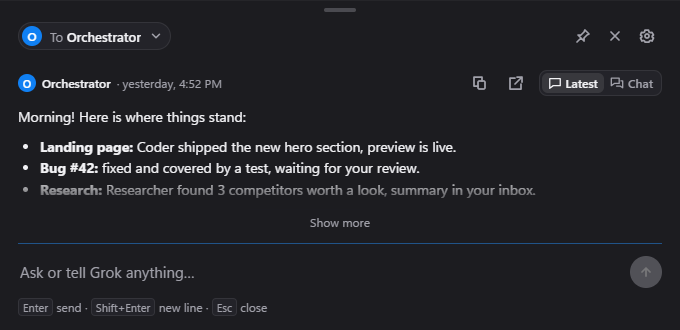
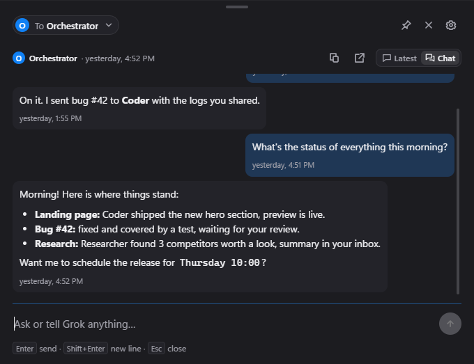
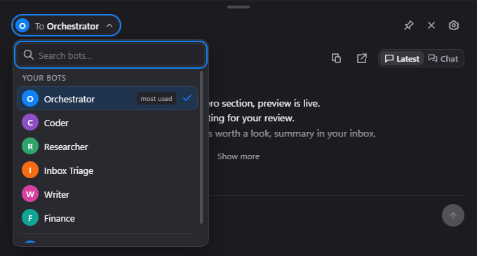
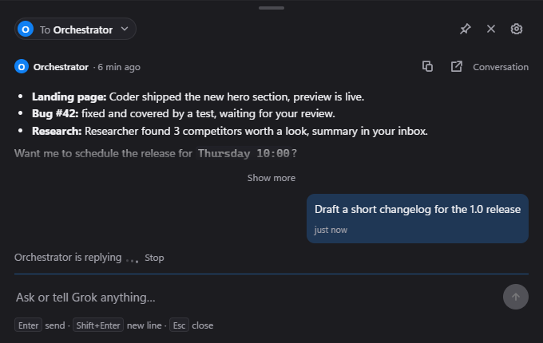
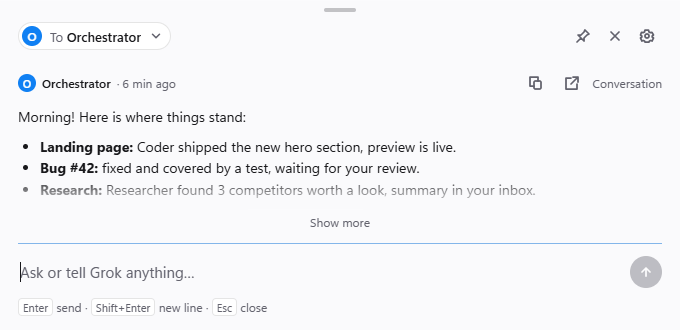
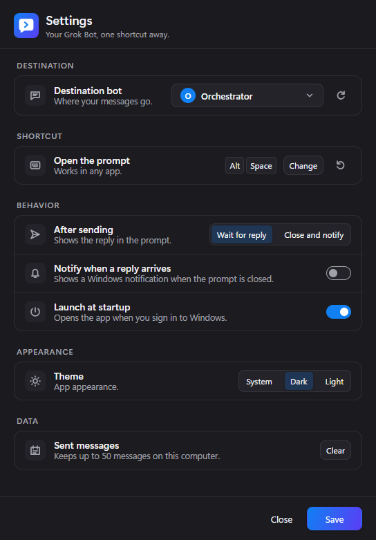

<p align="center">
  
</p>

<h1 align="center">Grok Bot Helper</h1>

<p align="center"><b>Your Grok Bot, one shortcut away — on Windows.</b></p>

<p align="center">
  <a href="https://github.com/pedrofigueiredo25/grok-bot-helper/actions/workflows/ci.yml"></a>
  
  <a href="LICENSE"></a>
  
</p>

<p align="center">
  <a href="https://github.com/pedrofigueiredo25/grok-bot-helper/releases/latest"><b>⬇ Download for Windows</b></a>
</p>

<p align="center">
  
</p>

On macOS, Grok Bot ships with a built-in quick prompt you can summon from anywhere with a shortcut. **On Windows that feature doesn't exist yet** — so we built it. Grok Bot Helper is a small tray app that brings that "press a shortcut, talk to your bot" experience to Windows, and is meant to grow into a general-purpose helper around the Grok Bot desktop app.

> **Unofficial, community project.** Not affiliated with xAI or the makers of Grok Bot. It relies on Grok Bot links and local files that are not documented and may change with Grok Bot updates. It only **reads** those files on your computer and never sends your data anywhere.

## Features

- **Quick prompt from anywhere** — press `Alt+Space` (configurable) in any app, type, hit `Enter`. Your message goes straight to the bot you picked.
- **See the reply right there** — the latest reply shows up in the prompt with proper formatting (lists, bold, code). Switch to **Conversation** to see the recent back-and-forth. If the bot answers in several messages, the prompt keeps reading until it stops writing, and notifies you once.
- **Send the text you selected** (optional) — pick a shortcut in Settings, select text in any app and press it: the prompt opens with that text, ready to send. Off by default.
- **Long messages, in parts** — Grok Bot links take up to 1000 characters. For longer messages the prompt offers **Send in N parts**: it splits at paragraphs or sentences, numbers each part `(1/N)`, and sends them one at a time, waiting for each to arrive. You can cancel midway.
- **Prompt templates** — save snippets like *Summarize:* or *Translate to English:* in Settings, then press `Ctrl+T` in the prompt to put one at the start of your message.
- **Pick any of your bots** — the bot picker lists the bots from your Grok Bot app, with search. Switch with `Ctrl+K` without leaving the prompt.
- **Wait or get notified** — keep the prompt open until the reply arrives, or let it close and get a dot on the tray icon (and an optional Windows notification).
- **A real window when you want it** — drag it, resize it, pin it so it stays open; it remembers where you left it.
- **Knows when Grok Bot can't take messages** — warns you when you're out of Grok Bot usage instead of waiting forever.
- **Small touches** — copy a reply, open the conversation in Grok Bot, browse your previous prompts with `↑`/`↓`, light and dark themes, launch at startup.

<table>
  <tr>
    <td></td>
    <td></td>
  </tr>
  <tr>
    <td align="center"><sub>Conversation view</sub></td>
    <td align="center"><sub>Pick any of your bots (<code>Ctrl+K</code>)</sub></td>
  </tr>
  <tr>
    <td></td>
    <td></td>
  </tr>
  <tr>
    <td align="center"><sub>Waiting for the reply</sub></td>
    <td align="center"><sub>Light theme</sub></td>
  </tr>
</table>

<p align="center">
  
</p>

<sub>Screenshots use fictional bots and messages.</sub>

## How it works

1. A global shortcut opens a floating prompt (Electron, lives in the tray).
2. When you send, the app opens a Grok Bot deep link — `grokbot://app/v1/prompt?id=<bot>&text=<text>` (up to 1000 characters; a longer message goes out as numbered parts, one link each, only after you confirm). Grok Bot may ask you to confirm *"Add message for Grok?"*; it has a *"Don't show again"* option. If you enable it, any `grokbot://` link can add text without asking, so decide with that in mind.
3. To show replies and your bot list, the app **reads** Grok Bot's local cache in `%APPDATA%\Grok Bot` — nothing is written there and nothing leaves your PC.

## Install

**Requirements:** Windows 10 or 11 (64-bit) and the [Grok Bot](https://cursor.com/download/bot) desktop app, opened at least once.

**[⬇ Download the latest installer](https://github.com/pedrofigueiredo25/grok-bot-helper/releases/latest)** — grab `Grok-Bot-Helper-Setup-<version>.exe` from the release assets.

When you run the installer:

1. It installs for your user only, in one click, no admin rights needed.
2. The installer isn't code-signed yet, so Windows SmartScreen may say *"Windows protected your PC"*. Click **More info → Run anyway**.
3. On first launch a welcome screen lists your Grok Bot bots (the most used one is preselected). Click **Save and get started**.
4. Press the shortcut it shows (default `Alt+Space`; if that's taken, the app picks a free one and tells you).

To uninstall: **Windows Settings → Apps**.

## Usage

| Action | What it does |
| --- | --- |
| Shortcut (default `Alt+Space`) | Opens / closes the prompt |
| Selected-text shortcut (off by default, set it in Settings) | Copies the text selected in the app in front and opens the prompt with it (up to 1000 characters, added after any draft) |
| `Enter` | Sends the message (over 1000 characters, click **Send in N parts** to split it, up to 10 parts) |
| `Shift+Enter` | New line |
| `Esc` or click outside | Closes the prompt (unless it's pinned) |
| `Ctrl+K` | Pick another bot |
| `Ctrl+T` | Insert a saved template at the start of the message (add templates in Settings) |
| `↑` / `↓` in an empty prompt | Browse your previous prompts |
| `Ctrl+,` | Open settings |
| Double-click the header | Reset the prompt's size and position |

Tray icon: left-click opens the prompt; right-click shows **Open prompt**, **Settings…**, **Reset prompt position** and **Quit**.

Settings are stored in `%APPDATA%\grok-bot-helper\settings.json`.

**About the selected-text shortcut:** it presses `Ctrl+C` for you in the app in front (through PowerShell and .NET `SendKeys`, both part of Windows), reads the copied text and then puts your previous clipboard back. Text, HTML, RTF and images are restored; other formats (such as copied files) can't be. The copied text is never logged or saved. If Windows clipboard history (`Win+V`) is on, the copied selection may show up there. It doesn't press `Ctrl+C` in a terminal (cmd, PowerShell, Windows Terminal), where it would stop the running program. If the clipboard held a secret marked by a password manager as private, it is cleared instead of written back, so the secret doesn't lose that mark. It needs Ctrl or Alt and can't use the Windows key or `Ctrl+C` itself; release the keys after pressing it so the copy isn't mixed with them.

## Troubleshooting

- **The shortcut does nothing** — check the tray icon is there. Another app may own the shortcut (PowerToys Run uses `Alt+Space` by default); the app shows a tray notice when it can't register it. Pick another one in Settings.
- **"Your message didn't reach Grok Bot"** — you may be out of Grok Bot usage (the prompt tells you when it resets), you cancelled Grok Bot's confirmation, or Grok Bot isn't running.
- **No bots in the list** — open Grok Bot once, then click the refresh button next to the bot picker in Settings.

## Build from source

```powershell
git clone https://github.com/pedrofigueiredo25/grok-bot-helper.git
cd grok-bot-helper
npm install
npm start
```

If `node_modules/electron/dist/electron.exe` is missing after `npm install`, run `node node_modules/electron/install.js`.

| Command | |
| --- | --- |
| `npm start` | Run the app |
| `npm test` | Unit tests (Node's built-in runner) |
| `npm run check` | Syntax check of every JS file |
| `npm run icons` | Regenerate icons from the SVGs |
| `npm run dist` | Build the Windows installer into `dist/` |

## Contributing

Contributions are very welcome — bug reports, ideas and pull requests. Start with the [contributing guide](CONTRIBUTING.md): it covers setup, the code rules (security of the Electron windows, i18n), how to test without spending Grok Bot usage, and the PR flow.

Fun fact: this project is built with an AI pair — Claude Code plans and reviews, Codex implements. The `.handoff/` folder and [`AGENTS.md`](AGENTS.md) show how that works. You don't need to use any of it to contribute.

## License

[MIT](LICENSE)
